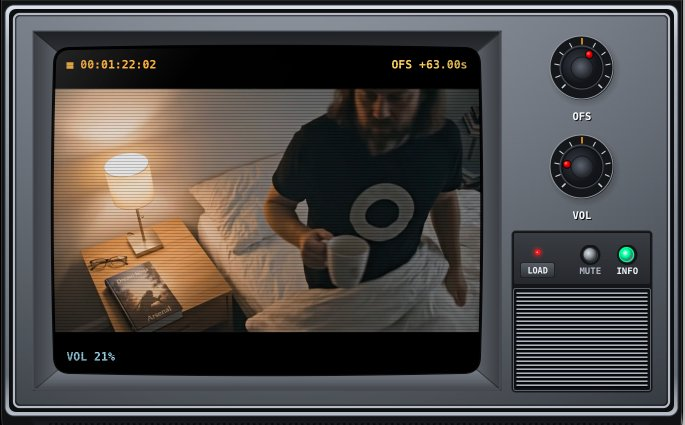

# Retro TV

A freeware VST3 video-displaying instrument plugin for audio DAWs — styled after a 1970s Studio Silver CRT television — by **f+l~x** ([flx.agency](https://felix.sk) / [felix.sk](https://felix.sk)).



Load any `.mp4`, `.mov`, or `.m4v` video into your DAW (tested in Reason, works in any VST3-compatible DAW), lock picture and stereo audio to your host transport timeline, trim sync down to single frames, and keep a video reference monitor right inside your rack or mixer.

## Download

Grab the prebuilt **macOS (Apple Silicon / `arm64`, macOS 14+)** VST3 plugin from **[GitHub Releases](https://github.com/slavkofelix/RetroTV/releases/latest)**:

1. Download and unzip `RetroTV-v1.0.0-macOS-arm64.zip`.
2. Copy `RetroTVVideo.vst3` to `~/Library/Audio/Plug-Ins/VST3/`.
3. Because the build is ad-hoc signed rather than Apple-notarized, clear Gatekeeper quarantine once after copying:
   ```bash
   xattr -cr ~/Library/Audio/Plug-Ins/VST3/RetroTVVideo.vst3
   ```

> Need Intel macOS, Universal binary, or Windows? See [Build from Source](#build-from-source) below.

---

## Features

- **Transport-Locked Video & Audio:** Follows DAW play/stop state and timeline position (`Audio` out on stereo VST3 bus, `OFS` timing offset from `-10.0s` to `+10.0s`).
- **Zero External Codec Dependencies:** Uses native **AVFoundation** (`VideoToolbox` / `AudioToolbox` / `Accelerate`) on macOS and **Media Foundation** (`IMFSourceReader`) on Windows — no FFmpeg installation or external runtime DLLs required.
- **Studio Silver 70s CRT Chassis:** Scalable vector Studio Silver finish with recessed mitered CRT funnel, toggleable **CRT FX** (scanlines, vignette, glass glare), OSD SMPTE/offset overlay, and rotating red-dot VHF tuner dials (`OFS` & `VOL`).
- **Service Hatch & Easter Eggs:** Click the louvered speaker grille below `MUTE` / `INFO` to open the Service Hatch:
  - `[-1F]`, `[0s]`, `[+1F]`: Single-frame sync trim and quick reset.
  - `[CRT]`: Toggle scanline & glass glare FX.
  - `[CHANNEL 1]` / `[CHANNEL 2]`: **`CHANNEL 2` (Default)** plays your loaded DAW video; **`CHANNEL 1`** switches to the bundled looping Easter-egg clip without disturbing your loaded clip.
  - **Teletext Fastext (`Red / Green / Yellow / Blue`):** Opens retro `P100`–`P400` Teletext pages right on the CRT.

---

## Usage

1. Load **Retro TV** (`flx.agency`) as a VST3 instrument in your DAW.
2. **Drag & drop** a video file (`.mp4`, `.mov`, `.m4v`) directly onto the CRT screen — or click **`LOAD`**.
3. Turn **`OFS`** (Shift+drag or scroll wheel for fine adjustment) to align the video cue to your project timeline.
4. Use **`VOL`**, **`MUTE`**, and **`INFO`** (toggle SMPTE / level OSD).
5. Your loaded video path, offset, volume, mute, and CRT FX state save and restore with your DAW project.

---

## Build from Source (No Third-Party Codecs Required)

### Prerequisites
- CMake `>= 3.25` and a C++17 compiler (Apple Xcode Command Line Tools on macOS, or MSVC / Visual Studio on Windows)
- Git

### 1. Clone the repository & VST3 SDK

```bash
git clone https://github.com/slavkofelix/RetroTV.git
cd RetroTV
git clone --recursive https://github.com/steinbergmedia/vst3sdk.git third_party/vst3sdk
```

### 2. Configure & Build

**macOS (AVFoundation — native frameworks only):**

```bash
cmake -S . -B build -DCMAKE_BUILD_TYPE=Release
cmake --build build -j
```

This builds `build/VST3/Release/RetroTVVideo.vst3`, runs Steinberg's `validator`, bundles `assets/practice-crazy.mp4`, ad-hoc signs the bundle, and automatically installs it to:

```text
~/Library/Audio/Plug-Ins/VST3/RetroTVVideo.vst3
```

*(Optional universal macOS `arm64 + x86_64` build: add `-DSMTG_BUILD_UNIVERSAL_BINARY=ON` during `cmake -S . -B build`.)*

**Windows (Media Foundation — source included, test in Visual Studio / MSVC):**

```powershell
cmake -S . -B build -A x64
cmake --build build --config Release
```

Copy `build\VST3\Release\RetroTVVideo.vst3` to `C:\Program Files\Common Files\VST3\`.

### 3. Run Unit Tests & Validator

```bash
./build/bin/Release/RetroTVVideoTests assets/practice-crazy.mp4
./build/bin/Release/validator ~/Library/Audio/Plug-Ins/VST3/RetroTVVideo.vst3
```

---

## Troubleshooting (macOS Gatekeeper)

If you share a compiled `.vst3` binary without Apple Developer ID notarization, macOS may quarantine downloaded bundles. Users can clear the quarantine attribute after copying the plugin to `~/Library/Audio/Plug-Ins/VST3/` with:

```bash
xattr -cr ~/Library/Audio/Plug-Ins/VST3/RetroTVVideo.vst3
```

---

## License

Released as free, open-source software under the [MIT License](LICENSE).  
Built with the Steinberg VST 3 SDK (MIT License).
